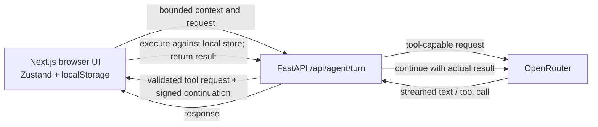

# TaskFlow

TaskFlow is a project and task workspace that keeps its working data in your browser. It combines a Kanban board, task list, project dashboards, and FlowMate, an AI assistant that can plan projects and request real task changes. No account or server-side task database is required.

> **Deployment gate:** Local Docker on port 8080 has been verified. GitHub hosting and Google Cloud Run deployment have not. The original company deploy and destroy workflows are unsafe to publish or activate as-is. See [Deployment safety](#deployment-safety) before any push.

## Featuress

- Create, select, edit, and delete multiple projects. Each project has its own board, list, dashboard, analytics, and FlowMate conversation; All Projects is a separate workspace view.
- Create, edit, delete, search, filter, sort, and reorder tasks. Kanban drag and drop, keyboard movement, and the task list use the same Zustand store. Tasks support priorities, tags, notes, checklists, and optional due date, time, and IANA timezone.
- View live completion, status, priority, timeline, and overdue metrics computed from stored tasks. Date-only deadlines expire after the applicable local day; timed deadlines use their specified timezone when present.
- Collapse and expand the sidebar; use light or dark theme; switch between English and Arabic with RTL layout.
- Export one project or the full workspace as JSON. Version 2 backups include task metadata and correctly owned FlowMate conversations. Import validates the file, remaps IDs for Import as New, and accepts older date-only/version 1 backups. Explicit Clear removes only TaskFlow-owned browser data.
- Ask FlowMate to plan a project, review and edit its proposal, then approve creation. It can also request task creation, updates, movement, and other supported operations. Actual changes run in the browser store and appear immediately in the board, list, and analytics.

## Technology stack

| Layer | Technology |
| --- | --- |
| Frontend | Next.js App Router static export, React, TypeScript, Tailwind CSS, Zustand, dnd-kit, Motion for React, Recharts, Zod |
| Backend | Python 3.12+, FastAPI, Pydantic, uv, HTTPX |
| AI | OpenRouter tool-capable model, streamed responses, validated browser tool execution, signed short-lived continuation |
| Storage | Browser localStorage via Zustand persistence; no task or chat database |
| Tests | Vitest, Playwright Chromium, pytest, Ruff, ESLint, TypeScript |
| Container | Multi-stage Docker image; non-root FastAPI serves exported Next.js files and `/api/*` on one port |

## Architecture



The browser owns projects, tasks, draft proposals, and conversations keyed by stable project ID (plus a separate `all` conversation). FastAPI cannot read localStorage directly. It receives bounded context for a request, validates model tool calls, and returns them for browser execution. The browser validates project scope and arguments, asks for confirmation for destructive or bulk actions, updates the shared store, and returns the actual result for model continuation. Proposal approval creates a project and its tasks together; generation alone does not create data.

The exported Next.js frontend is served by FastAPI in the production image. Production calls use same-origin `/api`; local two-port development uses a public API base URL and narrowly enabled development CORS. FlowMate uses validated tool calling, browser-side execution, and project-scoped conversations. Cloud deployment requires a separate security review before production use.

## Project structure

```text
frontend/           Next.js UI, Zustand domain/store, browser agent executor, Vitest and Playwright
backend/app/        FastAPI routes, OpenRouter orchestration, prompts, tool schemas
backend/tests/      Backend regression tests

scripts/            Local integrity and static contract checks
Dockerfile          Single-image production build
compose.local.yaml  Optional two-service development setup
.env.example        Root environment template (no credentials)
```

The application follows the approved TaskFlow Editorial Design. Original specifications, design assets, and local AI development instructions are maintained separately and are not required to build or run the application.

## Local development

Requirements: Node.js 22, Python 3.12+, [uv](https://docs.astral.sh/uv/), npm, and Chromium for Playwright. From the repository root, use two terminals:

```powershell
cd backend
uv sync --frozen
$env:TASKFLOW_DEV_CORS = "true"
# Set OPENROUTER_API_KEY in this shell only if testing live FlowMate.
uv run uvicorn app.main:app --reload --host 127.0.0.1 --port 8000
```

```powershell
cd frontend
npm ci
$env:NEXT_PUBLIC_API_BASE_URL = "http://localhost:8000"
npm run dev -- --hostname 127.0.0.1
```

Open `http://localhost:3000`. The API health endpoint is `http://localhost:8000/api/health`. Other project features and mocked AI tests do not require a live OpenRouter key. Never put an API key in a `NEXT_PUBLIC_*` variable.

For a production-like local run from the repository root:

```powershell
docker build -t taskflow:local .
docker run -d --name taskflow-local --env-file .env -p 8080:8080 taskflow:local
Invoke-RestMethod http://localhost:8080/api/health
(Invoke-WebRequest http://localhost:8080/ -UseBasicParsing).StatusCode
docker ps --filter "name=^/taskflow-local$"
```

Copy `.env.example` to an ignored root `.env` and set server-only values locally before `docker run`. Docker does not load this file automatically. The command creates a persistent container; if `taskflow-local` already exists, start it with `docker start taskflow-local`, or stop and remove **only that container** before creating a replacement after rebuilding. Recreate it after changing `.env`, because an existing container retains its environment. The image and health check use `PORT` (default 8080); map the same container port if you change it. The root `.env` is excluded from both Git and Docker build context.

## Environment variables

Use [.env.example](.env.example) and [frontend/.env.example](frontend/.env.example) as templates. They contain placeholders only.

| Variable | Purpose |
| --- | --- |
| `OPENROUTER_API_KEY` | Backend-only credential required for live FlowMate requests |
| `OPENROUTER_MODEL` | Optional tool-capable model override |
| `TASKFLOW_SIGNING_KEY` | Stable backend key for signed continuations; set a strong value for a multi-instance runtime |
| `TASKFLOW_DEV_CORS` | Set to `true` only for the local :3000 → :8000 split |
| `PORT` | FastAPI ingress port inside the container, default 8080 |
| `NEXT_PUBLIC_API_BASE_URL` | Public, non-secret frontend API origin for local split development; leave empty for same-origin production |

Do not commit real values. `NEXT_PUBLIC_*` values are embedded in browser assets.

## Testing

Run from the indicated directories:

```powershell
cd frontend
npm ci
npm run lint
npm run typecheck
npm run test
npm run build
npx playwright install chromium
$env:CI = "1"  # Use Playwright Chromium; otherwise the config expects installed Google Chrome.
npm run test:e2e -- --workers=1
cd ../backend
uv sync --frozen
uv run ruff check app tests
uv run pytest -q
cd ..

Internal integrity and reference checks are maintained locally because they depend on private company files and development references excluded from the public repository.
```

Playwright tests use isolated browser contexts. Set `TASKFLOW_E2E_URL=http://localhost:8080` to test the running Docker app instead of starting the development server. Most FlowMate regression tests mock provider responses and verify actual task state; live OpenRouter tests are opt-in and require a local key. The full browser suite may contain environment-sensitive pointer drag tests; inspect any failure before treating it as a product regression.

## Data management

Zustand persists TaskFlow data under the browser's `taskflow-v1` localStorage key. Data does not synchronize between devices or browser profiles. Back up before clearing a browser profile or removing local storage.

- **Export Selected Project:** project, its tasks and checklists, deadline fields, and only its FlowMate conversation.
- **Export All Projects:** all projects and tasks, each owned conversation, and the All Projects conversation when present.
- **Import as New:** validates the whole JSON file before changing storage and remaps project, task, checklist, and project-conversation message IDs while preserving ownership and order. **Replace Existing** is explicitly confirmed and affects one uniquely matched project.
- **Clear:** requires exact `CLEAR`, removes TaskFlow projects, tasks, and conversations, and leaves unrelated browser storage alone.

Version 1 exports without conversations remain importable. Imports do not replay AI tools or task mutations. Backups contain user-visible conversation text; common credential patterns are redacted, but arbitrary secrets typed into chat cannot be identified reliably. Review a backup before sharing it. Export size and schema limits apply.

## Deployment safety

**Local Docker is verified; GitHub hosting and Cloud Run are not.** The image is designed for one Cloud Run container on `0.0.0.0:$PORT`, with FastAPI serving the frontend and API on one URL. No Cloud Run service, Secret Manager integration, or production health probe has been tested here.

The preserved original company `.github/workflows/deploy.yml` triggers on branch pushes, uses a fixed Google Cloud project and JSON service-account credentials, forwards secrets into Terraform/Cloud Run plaintext environment values, and overlaps Terraform and `gcloud` deployment. Its `destroy.yml` can run on branch deletion. **Do not publish or activate these original workflows.** The five originals are kept locally and byte-for-byte unchanged; a separate, approved deployment-safety plan is required before staging any replacement. The independent CI workflow does not neutralize the originals.

## Security and limitations

The OpenRouter key is read only by FastAPI. Tool schemas, browser scope checks, signed continuations, bounded requests, and confirmations reduce errors, but the anonymous AI endpoint still creates abuse and provider-cost risk if exposed publicly. Client-reported mutations cannot be independently verified by a server with no authoritative task database. Production needs separately reviewed access, secret, rate/cost, and deployment controls.

Browser localStorage has quota and device-loss risks. TaskFlow has no login, cloud synchronization, team collaboration, shared projects, or automatic cross-device recovery. The original brief's GitHub/Cloud Run delivery remains a future user-managed step.
